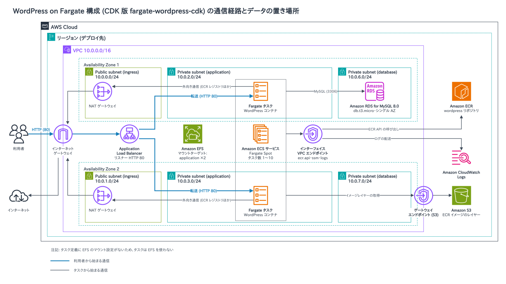

# **fargate-wordpress-cdk**

AWS FargateとCDKを使用して、コンテナ化されたWordPress環境を構築するための基盤。

---

## **アーキテクチャ**



編集元は [architecture.drawio](architecture.drawio) です。

### **主要コンポーネント**
1. **Amazon VPC**:
   - 2つのアベイラビリティゾーン（AZ）にまたがるプライベートおよびパブリックサブネット。
   - NAT Gatewayとインターネットゲートウェイを使用。

2. **Amazon ECS (Fargate)**:
   - コンテナ化されたWordPressアプリケーションをホスト。
   - タスクは2つのAZのプライベートサブネット（application）に配置。
   - Fargate Spotで実行し、CPU・メモリ使用率50%を目標に1〜10タスクで増減（初期値1）。

3. **Amazon RDS**:
   - WordPressデータベース（MySQL 8.0、db.t3.micro）。
   - シングルAZ構成（`multiAz`は未設定）。

4. **Amazon EFS**:
   - ファイルシステムとマウントターゲット（applicationサブネット）を作成。
   - タスク定義にマウント設定がないため、タスクはEFSを使わず、`wp-content`はタスクのエフェメラルストレージに置かれる。

5. **Elastic Load Balancer (ALB)**:
   - トラフィックをFargateタスクに分散。
   - HTTP（80）で受け付け、パス`/`でヘルスチェック（200・302を正常と判定）。SSL終端は未設定。

6. **VPCエンドポイント**:
   - ECR API・Systems Manager・CloudWatch Logsのインターフェイスエンドポイントと、S3のゲートウェイエンドポイント。
   - レジストリ（`ecr.dkr`）とSecrets Managerのエンドポイントはないため、レジストリへの通信はNAT Gatewayを経由。

7. **その他**:
   - **Amazon ECR**: カスタムDockerイメージの保存。
   - **CloudWatch Logs**: ログ管理とモニタリング。

---

## **セットアップ手順**

### **前提条件**
- AWS CLIがインストールされていること。
- CDK CLIがインストールされていること。
- Node.js 16.x以上がインストールされていること。

### **1. リポジトリのクローン**
```bash
git clone https://github.com/<your-repo>/fargate-wordpress-cdk.git
cd fargate-wordpress-cdk
```

### **2. 必要な依存関係をインストール**
```bash
npm install
```

### **3. CDKスタックをデプロイ**
```bash
cdk deploy --all
```

---

## **スタック構成**

- **network-stack**
  - VPC、NAT Gateway、セキュリティグループなどを作成します。
- **lb-stack**
  - ALBを作成します。
- **database-stack**
  - RDSを作成します。
- **storage-stack**
  - EFSを作成します。
- **container-stack**
  - ECR、ECSクラスター、およびFargateタスクを作成します。

---

## **今後の改善点**
1. Secrets ManagerまたはAWS Systems Manager Parameter Storeでクレデンシャル管理を自動化。
2. CloudFrontとWAFを導入してセキュリティとパフォーマンスを向上。
3. RDS Proxyを導入して接続管理を効率化。
4. EFSをタスクにマウントして`wp-content`を共有（タスク定義のボリューム設定と、EFS用セキュリティグループへのNFS（2049）の許可。現状は2049の許可がDB用セキュリティグループに付いている）。
5. RDSをマルチAZ構成に変更。
6. ALBにHTTPSリスナーを追加してSSL終端を実施。
7. `ecr.dkr`とSecrets ManagerのVPCエンドポイントを追加。

---
