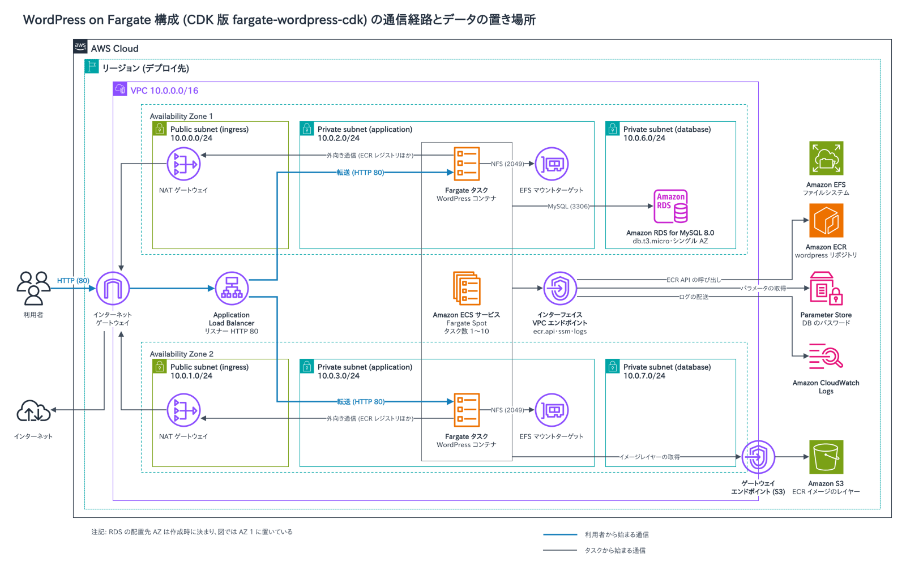

# fargate-wordpress-cdk

WordPressをAWS Fargateのコンテナで動かす環境を、AWS CDKで作るリポジトリです。タスクはFargate Spotで動き、CPUとメモリの使用率がそれぞれ50%になるよう、1〜10個の間で増減します。リージョンは東京(ap-northeast-1)を使います。

## 構成



図の元データは[architecture.drawio](architecture.drawio)。

| 要素 | 内容 |
|---|---|
| VPC | 2つのAZに、ingress(パブリック)、application、filesystem、databaseの4種類のサブネットを置く。filesystemサブネットには何も置いていないため、図では省いている |
| NATゲートウェイ | AZごとに1つ。applicationサブネットからの外向きの通信(ECRのレジストリなど)が通る |
| ECS(Fargate) | タスクはapplicationサブネットで動く。Fargate Spotで実行し、最初は1つ |
| RDS | MySQL 8.0(db.t3.micro)。シングルAZで、databaseサブネットに置く |
| EFS | WordPressの`wp-content`を、アクセスポイント経由でタスクにマウントする。タスクが増えても、アップロードしたファイルをタスクどうしで共有できる |
| ALB | HTTP(80)で受け付け、パス`/`でヘルスチェックする。200と302を正常とみなす |
| DBのパスワード | Systems Manager Parameter StoreのSecureStringに置く。CloudFormationが動的参照でRDSに設定し、タスクはECSのシークレットとして環境変数で受け取る |
| VPCエンドポイント | ECR API・Systems Manager・CloudWatch Logsのインターフェイスエンドポイントと、S3のゲートウェイエンドポイント。イメージのレイヤーはS3のエンドポイントから取る |

## 前提

- AWSアカウントと、管理者権限でログインできるAWS CLIのプロファイル
- Node.js 18以上
- AWS CLI v2。`aws login`を使うときは2.32.0以上
- Docker(WordPressのイメージを手元でビルドする。Apple SiliconのMacでも、Fargateに合わせてamd64のイメージを作る)
- Git

## 手順

以降のコマンドは、すべて1つのターミナルで、リポジトリのディレクトリから実行する。

### 1. クローンする

```bash
git clone https://github.com/mamezou/fargate-wordpress-cdk.git
cd fargate-wordpress-cdk
```

### 2. AWSにログインする

`aws login`でログインする。リージョンを聞かれたら`ap-northeast-1`を入力する。

```bash
aws login --profile wp-handson
```

このリポジトリのCDK CLI(2.121.1)は、`aws login`の認証情報を直接読めない。AWS CLIから認証情報を受け取るプロファイル`wp-handson-cdk`を作り、以降はこのプロファイルを使う。

```bash
aws configure set credential_process "aws configure export-credentials --profile wp-handson --format process" --profile wp-handson-cdk
aws configure set region ap-northeast-1 --profile wp-handson-cdk
export AWS_PROFILE=wp-handson-cdk
export AWS_REGION=ap-northeast-1
aws sts get-caller-identity
```

`aws sts get-caller-identity`の結果に自分のアカウントIDが出たら完了。ターミナルを開き直したときは、2つの`export`をもう一度実行する。

AWS SSOを使う人は、`aws login`の代わりに`aws sso login --profile <your-sso-profile>`でログインする。そのうえで、1行目の`aws configure set`にある`--profile wp-handson`(`credential_process`の文字列の中)を`--profile <your-sso-profile>`に置き換えて、上のコマンドを実行する。

### 3. DBのパスワードを作る

DBのパスワードはコードに置かず、Parameter StoreのSecureStringとして先に作る。CloudFormationはデプロイのときに、タスクは起動のときに、このパラメータを読む。

```bash
aws ssm put-parameter \
  --name /fargate-wordpress-cdk/db-password \
  --type SecureString \
  --value "$(openssl rand -hex 16)"
```

### 4. デプロイする

```bash
npm install
npx cdk bootstrap   # このアカウントとリージョンで初めてCDKを使うときだけ
npx cdk deploy --all
```

- 5つのスタック(network、loadbalancer、database、storage、container)を順に作る。全部で20分ほどかかる
- networkStackとcontainerStackでは、作られるIAMロールとセキュリティグループの一覧が出て`Do you wish to deploy these changes (y/n)?`と聞かれる。`y`を入力する
- 終わると、次のようにALBのDNS名が出る

  ```
  loadbalancerStack.LoadBalancerDns = ALB-xxxxxxxxxx.ap-northeast-1.elb.amazonaws.com
  ```

### 5. WordPressを開く

ブラウザで`http://<LoadBalancerDnsの値>`を開くと、WordPressのインストール画面が出る。インストール画面はURLを知っていれば誰でも開けるので、開いたらすぐにインストールを済ませる。ALBはHTTPだけなので、管理者のパスワードは暗号化されずに送られる。試すときは、ほかで使っていないパスワードにする。

## うまくいかないとき

- ブラウザで開くと503が返るときは、タスクがまだ起動していないか、起動に失敗している。ECSのコンソールでサービスの[イベント]と、停止したタスクの停止理由を見る。コンテナのログは、CloudWatch Logsの`containerStack-`で始まるロググループにある
- `npx cdk deploy`が`/fargate-wordpress-cdk/db-password`を見つけられずに失敗するときは、手順3のパラメータを作ったか、手順2の`AWS_REGION`が設定されているかを見る

## 削除

起動している間は、NATゲートウェイ(2つ)、ALB、RDS、Fargate、インターフェイスVPCエンドポイント、EFSの料金がかかる。使い終わったら削除する。

```bash
npx cdk destroy --all
aws ssm delete-parameter --name /fargate-wordpress-cdk/db-password
```

確認を求められたら`y`を入力する。削除は15分ほどかかる。

コンテナのログのロググループと、CDKが使うLambda関数のロググループは削除されずに残る。次のコマンドで名前を表示し、1つずつ削除する。

```bash
aws logs describe-log-groups --log-group-name-prefix containerStack- --query 'logGroups[].logGroupName' --output text
aws logs describe-log-groups --log-group-name-prefix /aws/lambda/containerStack- --query 'logGroups[].logGroupName' --output text
aws logs delete-log-group --log-group-name <表示された名前>
```

## スタック構成

| スタック | 作るもの |
|---|---|
| networkStack | VPC、NATゲートウェイ、VPCエンドポイント、セキュリティグループ |
| loadbalancerStack | ALB、ターゲットグループ |
| databaseStack | RDS |
| storageStack | EFS、アクセスポイント |
| containerStack | ECR、ECSクラスター、タスク定義、サービス、オートスケーリング。手元でビルドしたイメージは、CDKのカスタムリソースがECRにコピーする |

`npm test`は、DBのパスワードをParameter Storeから読むこと、タスクが`wp-content`をEFSにマウントすること、NFSの許可がEFS用のセキュリティグループに付いていることを確かめる。

## 改善の候補

| 候補 | 理由 |
|---|---|
| タスクを常に2つ以上にし、一部をFargate(Spotでない)で動かす | 今はSpotのタスク1つだけなので、Spotの中断でサイトが止まる |
| RDSをマルチAZにする | 今はシングルAZで、AZの障害でDBが止まる |
| ALBにHTTPSのリスナーを足す | 今はHTTPだけで、ログインのパスワードが暗号化されない |
| WordPressの認証キーとソルトを`wp-config.php`に設定する | `app/entrypoint.sh`はDBの接続情報だけを書き込み、キーとソルトはサンプルのままになる |
| `ecr.dkr`のVPCエンドポイントを足す | 今はレジストリへの通信がNATゲートウェイを通り、NATの通信料がかかる |
| WordPressのイメージの版を固定する | `app/Dockerfile`は`wordpress:latest`を使うため、ビルドする時期で版が変わる |
| filesystemサブネットを使うか、なくす | EFSのマウントターゲットはapplicationサブネットにあり、filesystemサブネットは使っていない |
